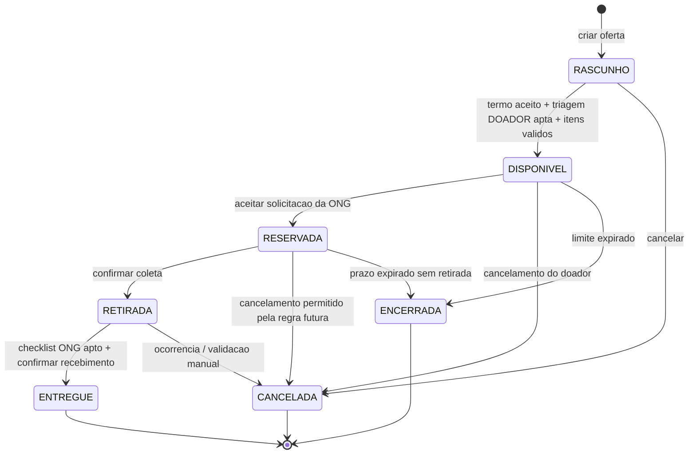

# Ciclo de vida da doação (proposta)

**Observação:** os estados e as transições são proposta de implementação para HU06/HU07/HU09. O prazo automático de encerramento exige processo agendado no backend; um `CHECK` SQL não consegue fazê-lo sozinho.
